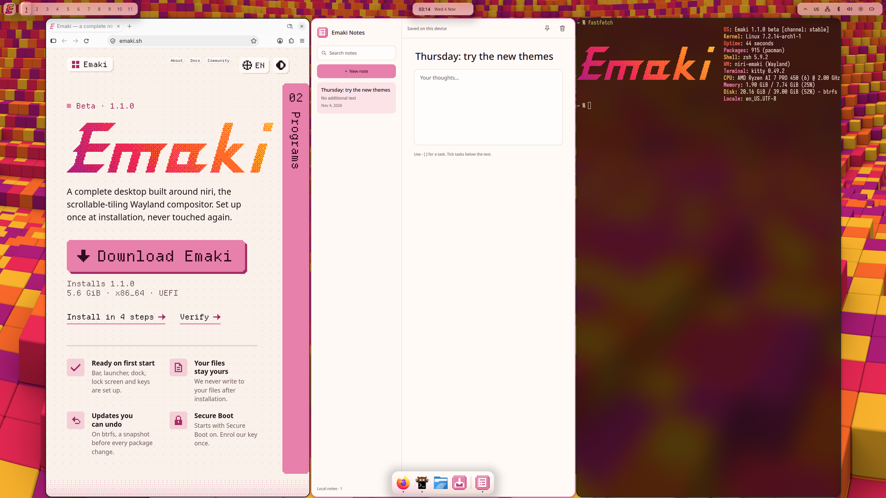
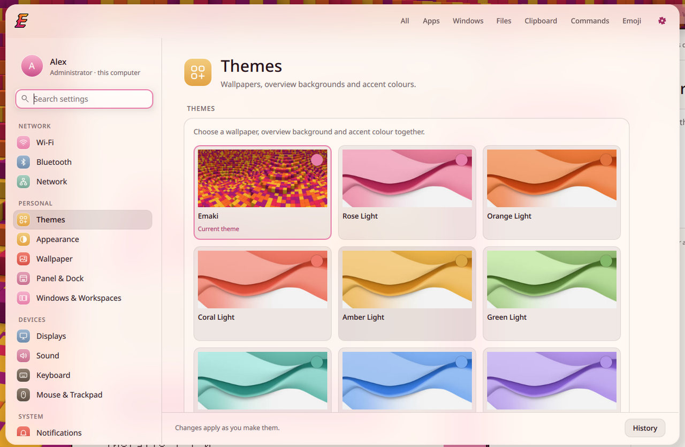
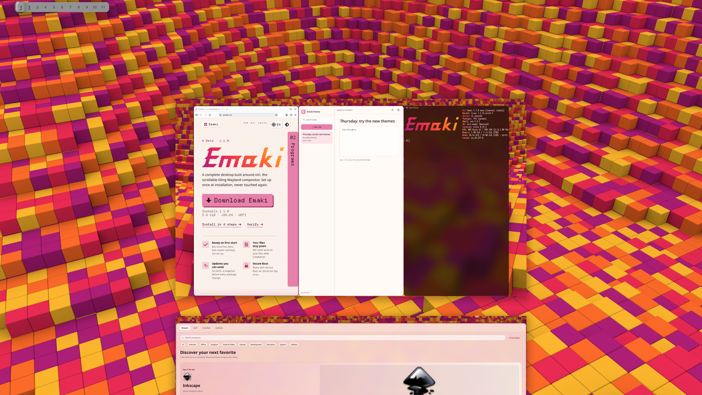
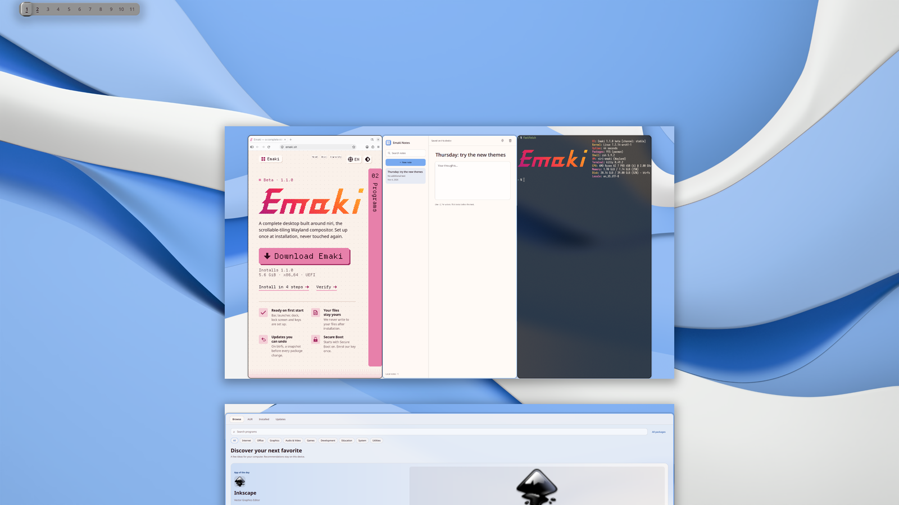
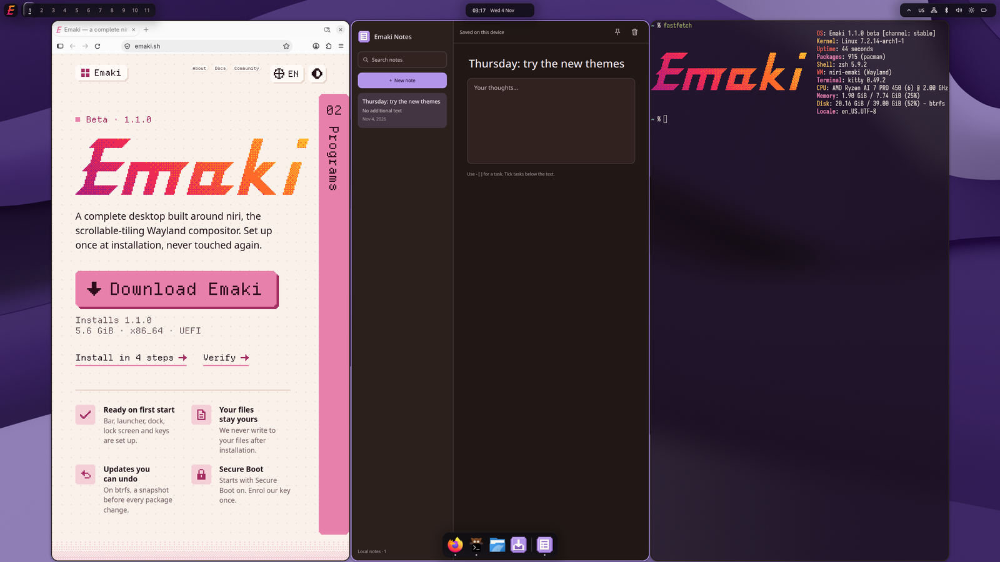
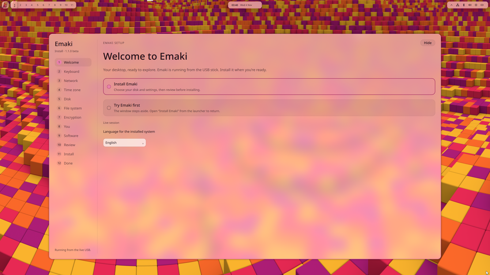
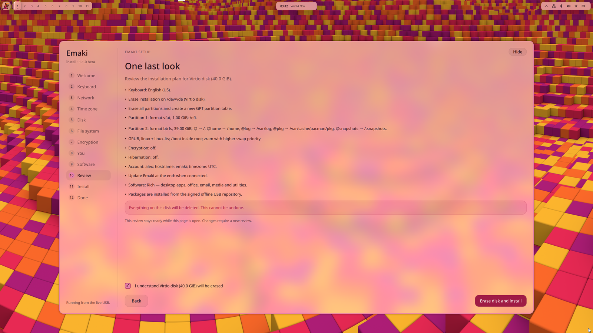
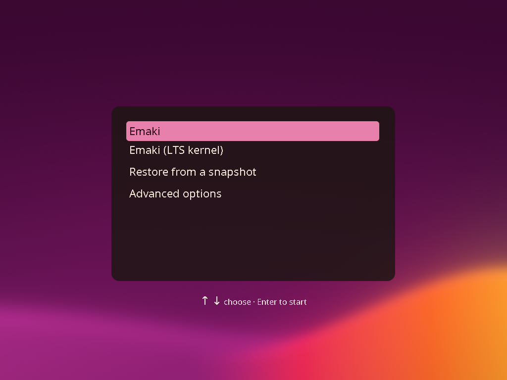
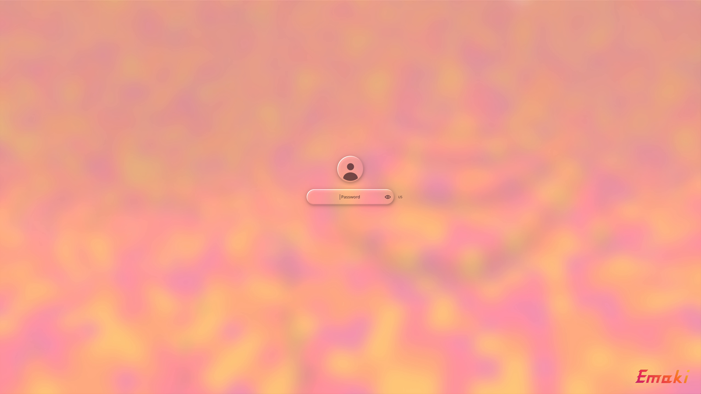

# Emaki

Emaki is an Arch-based desktop built around **niri-emaki**, a fork of the
[niri](https://github.com/niri-wm/niri) scrollable-tiling Wayland compositor, and its own
[Quickshell](https://quickshell.org) shell. Warm colours, glass panels, and themes: one choice
in Settings changes the wallpaper, the overview background and the accent together. The Emaki
theme is a strip of coloured cubes across your workspaces; eighteen more come with it, eight
colours in light and dark plus Silver and Graphite.

**Status: 1.1.0 beta — ready for everyday use.** See [Release stages](#release-stages).
Releases are tested in QEMU with UEFI firmware (OVMF) and on two real computers, an AMD
laptop and a MacBook, see [Tested hardware](#tested-hardware). Where the project is heading:
[PLANS.md](PLANS.md).

Since 0.12, Emaki speaks English, Latin American Spanish, Brazilian Portuguese, German, French
and Russian: in the installer, the desktop, Programs & Updates and Notes.

| | |
|---|---|
|  |  |
| Settings › Themes: one choice changes the wallpaper, the overview background and the accent | The overview, Super+O |
|  |  |
| The overview in the Blue Light theme | Violet Dark, with the dark appearance switched on in Settings › Appearance |
|  |  |
| The live session from the USB stick | The installer, last step before writing to disk |
|  |  |
| GRUB: two kernels and the btrfs snapshots | The login screen |

## Release stages

- **0.x — alpha.** The rawest stage, for the people building Emaki. Things can break between
  updates and data can be lost. Do not install it on a computer you depend on; if you try it, use
  a spare machine and keep backups.
- **1.x — beta.** Ready for everyday use. Rough edges remain and updates keep fixing them; if
  something is wrong, report it in the issues.
- **2.0 and later — no label.**

Beta here is the stage of Emaki as a whole, not a pre-release: every new version reaches the
`testing` update channel first and `stable` after it passes the checks.

## What's inside

- **niri-emaki** (`packaging/niri-emaki/`) — niri 26.04 with fourteen patches: the living
  wallpaper, glass capture for the shell, a seamless handoff from the login screen, an
  animated overview backdrop, crisp cursors at fractional scale and a distinct exit status
  when no GPU renderer can be created, plus locked-session capture protection, static-blur
  occlusion accounting, preserved keyboard focus for mapped shell layers, and a trusted
  authentication connection with compositor input isolation and a physical Ctrl+Alt+Delete proof action,
  safety key bindings that no other program can change during a session, the shell's own
  screen recordings marked as the shell's, fullscreen windows that start below a visible panel,
  and tiled window positions for the window switcher's pictures.
- **Themes** (`themes/`, `packaging/emaki-themes/`) — the Emaki cube strip and eighteen ribbon
  themes, each with a wallpaper, an overview video and a preview. The scenes that make them are
  in `art/cubes/` and `art/ribbons/`.
- **The shell** (`shell/`) — bar islands (workspaces, clock, system, privacy), dock,
  launcher, notifications and on-screen display on liquid glass. The login screen (a greetd
  greeter) and the lock screen are drawn by the same shell.
- **The `emaki` command** (`crates/`) — system map and state, and niri window/workspace
  commands from the terminal.
- **The installer** (`installer/`) — a root worker with a JSON protocol, a command-line client
  and a graphical window.
- **The ISO profile** (`iso/`) — archiso 91 releng with the Emaki overlay.
- **Packages** (`packaging/`) — `emaki`, `emaki-apps`, `emaki-config`, `emaki-desktop`,
  `emaki-installer`, `emaki-keyring`, `emaki-mirrorlist`, `emaki-nvidia`, `emaki-shim-signed`,
  `emaki-font-iosevka`, `emaki-sudo-key`, `emaki-themes`, `snapguard`, `niri-emaki`, `quickshell-emaki`,
  `xdg-desktop-portal-gnome-emaki`.
- **Art** (`art/`, `cursors/`, `fetch/`, `boot/`) — the wallpaper, logo, cursors, GRUB
  background and boot splash, with the scripts that make them.

## The ISO

Download: https://dl.emaki.sh/iso/1.1.0/emaki-1.1.0-x86_64.iso. Its checksum and signature
are at the same address with `.sha256` and `.sig` added; the key that signed it is
https://dl.emaki.sh/iso/1.1.0/emaki-signing-key.asc.

`emaki-1.1.0-x86_64.iso` boots into a live Emaki session with the installer open. Emaki
needs a computer with 64-bit UEFI; legacy BIOS computers are refused by the installer. If
Windows on the computer uses BitLocker or device encryption, save its recovery key first:
changing firmware security settings can make Windows ask for it.
Secure Boot can stay on if the firmware trusts Microsoft's third-party UEFI certificate (2011
or 2023); if it trusts neither, turn that option on in the firmware settings. The first time
the stick starts with Secure Boot on, it reports a security violation and opens the blue key
management screen (MokManager): press a key, then choose "Enroll key from disk" → `EMAKI` →
`emaki.cer` → "Continue" → "Yes" → "Reboot". "View key" shows the key's fingerprint, which
must match the release page. From then on the stick starts with Secure Boot on. An installed
system gets its own key, which you confirm once at its first start with the one-time password
shown on the installer's last screen.
The installer offers:

- **Erase disk** with **btrfs** (recommended: snapper snapshots that you can boot from the GRUB
  menu) or **ext4** (no system snapshots).
- **Manual partitioning**: create, delete and format partitions in the installer itself, then
  choose mount points; an existing EFI system partition can be reused. Nothing is written
  until you press Install.
- **Install alongside Windows**: keep Windows and give part of its free space to Emaki, at
  least 32 GiB. Windows appears in Emaki's boot menu, and choosing it restarts the computer
  straight into Windows. The EFI system partition is shared and never formatted. The installer
  refuses Windows that is asleep (hibernation or Fast Startup) or encrypted with BitLocker, and
  says what to change in Windows first.
- **Offline installation** from the signed package repository on the USB stick. When the
  machine is online, the installer can also update Emaki at the end.

The installed system gets GRUB with `linux` and `linux-lts`, zram and NetworkManager. The
installer offers two software sets. **Minimal** is the desktop with Dolphin, Firefox and kitty.
**Rich** (preselected) adds LibreOffice, Thunderbird, Okular, Kate, Gwenview, Ark, Haruna,
Elisa, Spectacle, OBS Studio, qBittorrent, KeePassXC, Flatpak, Partition Manager,
Filelight, System Monitor, ISO Image Writer, KCharSelect, Skanlite, printing and
media codecs. Not in 1.1.0: BIOS boot, installing alongside another Linux.

## Security notes

Ordinary apps running in your account outside a sandbox, including non-Flatpak apps,
can capture your screen and send key presses or pointer input without asking
(wlr-screencopy, virtual-keyboard, wlr-virtual-pointer).
niri blocks direct access to these protocols for clients it recognises as sandboxed,
such as Flatpak apps using a sandbox connection (security-context-v1).

If the lock-screen program crashes, the desktop stays locked, but niri accepts another
program as the replacement locker (ext-session-lock-v1).
A malicious program already running in your account could take over and unlock the
session without your password.

## Tested hardware

| Machine | Emaki | Works | Known issues |
|---|---|---|---|
| MacBook Pro (Retina, 13-inch, Early 2015) | 1.1.0 | Update from 1.0.1 from the testing channel, restart; then a fresh installation from USB, login, desktop, Wi-Fi, switching themes in Settings, no failed services | Switching the update channel in Settings closes the password window at once; `sudo emaki-update-channel set` in a terminal works. The update window does not show the download progress |
| ThinkPad P14s Gen 7 AMD | 1.0.1 | Everyday use: Emaki added to an existing Arch installation at 0.9.0, then updated with `pacman -Syu` up to 1.0.1 | Not installed from USB; this laptop starts with rEFInd, so Emaki's boot menu refresh after updates does not run on it |

Earlier versions on these machines: [docs/tested-hardware.md](docs/tested-hardware.md).

Installed Emaki on another machine? Reports are welcome in the issues.

MacBook is a trademark of Apple Inc. and ThinkPad a trademark of Lenovo; Emaki is an independent project.

### Known issues in 1.1.0

- Hibernation: on the tested MacBook the session does not respond after resuming. Do not use
  hibernation.
- Next to Windows, Emaki installs, updates or removes system packages only while Windows is
  fully shut down. If Windows is asleep (hibernation or Fast Startup), Emaki stops before
  changing anything and says how to turn that off.
- Machines that still update from the old GitHub address print
  "emaki: missing required signature" once after moving to `pkgs.emaki.sh`; the next update is
  clean.
- In the installer, most keyboard layouts are shown only by a short code such as "al" in every
  language except English; searching by the English name still finds them.
- The boot menu of the installed system stays in English in every language.

## Updates

An installed system updates with `pacman -Syu`. Emaki's own packages come from the signed
`[emaki]` repository at `pkgs.emaki.sh`: `emaki-keyring` installs the signing key and
`emaki-mirrorlist` selects the `stable` channel. Everything else comes from Arch.

## Building

- **Packages**: each one builds with `makepkg` in its directory under `packaging/`;
  `emaki-config` and `emaki-installer` archive the committed checkout, so commit first.
  Details and local checks: [`packaging/README.md`](packaging/README.md).
- **ISO**: `iso/build.sh` runs inside a disposable Arch build VM with archiso 91, from a signed
  repository of the packages above. The build and the QEMU/OVMF test cycle
  (`tests/vm/run-iso.sh` and the `tests/vm/iso-*` scripts) are described in
  [`docs/iso.md`](docs/iso.md); the installer in [`installer/README.md`](installer/README.md).
- **Checks**: `make check` (configs and fast tests), `python3 tests/test-packaging.py`,
  `PYTHONPATH=installer python -m unittest discover -s installer/tests`, `iso/check.sh`.

## License

GPL-3.0-or-later, see [LICENSE](LICENSE). Copyright (C) 2026 Artur Yakymenko.

Patches to other projects keep those projects' licences: the niri patches in
`packaging/niri-emaki/` are GPL-3.0-or-later like niri; the eleven Quickshell patches in
`packaging/quickshell-emaki/` are LGPL-3.0-only like Quickshell.

Third-party fonts, images and map data keep their own licences. An installed system keeps each
package's licence texts under `/usr/share/licenses`; the installer's time-zone map contains
information from Timezone Boundary Builder and © OpenStreetMap contributors, available under the
Open Database License 1.0 ([`installer/ui/assets/README.md`](installer/ui/assets/README.md)).
